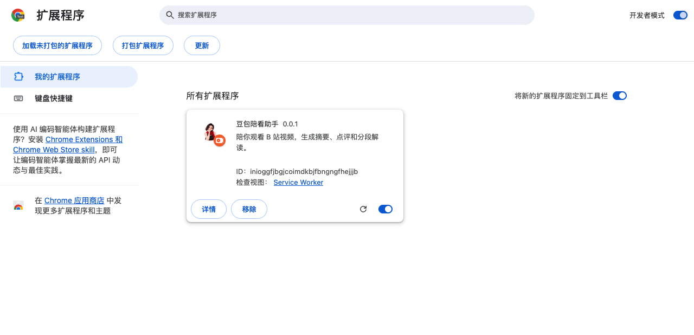

# 豆包陪看助手：安装、验收与 Chrome 应用商店发布操作手册

> **气泡位置修复复验（2026-10-28）**：针对用户新反馈，请使用包含气泡修复的 0.0.2 测试包。下文包含原位置更新和另装测试的方法；旧扩展不要点击「移除」。

> **2026-10-28 版本说明**：你已开始用户实操并提出五项问题；后续复验请使用 0.0.2 候选。此前 r11 的 Chrome 模拟浏览器回归已完成，0.0.2 仍需要你亲自复验，Phase 3 尚未整体通过。

> 切换时请关闭 r10，但不要移除它，以保留 r10 数据。0.0.2 可能被识别为另一份扩展，可能需要重新配置模型。r5 曾出现模型错误回显隐私问题，不要用 r5 验收真实模型。

适用对象：会打开网页、下载文件、解压文件和复制粘贴的个人使用者。无需编程，无需使用终端。核对日期：2026-10-28。商店按钮可能随更新改变，文中同时写出常见英文名称，方便对照。

**本机复验使用 0.0.2 候选包。** 它不是可直接提交商店的正式包，Phase 3 也尚未整体通过。本手册还说明正式上架的全过程；写好手册、上传草稿、提交审核、正式上线是四种不同状态。当前尚未提交 Chrome 应用商店。

## 目录

- [一、先分清手里的文件](#一先分清手里的文件)
- [二、安装候选包](#二安装候选包)
- [三、完成用户验收并记录结果](#三完成用户验收并记录结果)
- [四、正式上架前准备什么](#四正式上架前准备什么)
- [五、注册商店开发者账号](#五注册商店开发者账号)
- [六、上传正式包并填写商店页面](#六上传正式包并填写商店页面)
- [七、填写隐私和权限说明](#七填写隐私和权限说明)
- [八、提交审核与正式上线](#八提交审核与正式上线)
- [九、以后更新和处理驳回](#九以后更新和处理驳回)
- [十、遇到问题时怎么办](#十遇到问题时怎么办)

## 一、先分清手里的文件

| 你看到的名称 | 它是什么 | 什么时候用 |
|---|---|---|
| `chrome-mv3` 文件夹 | 可在本机加载的扩展；打开后能直接看到 `manifest.json` | 现在进行用户验收 |
| 名称带 `0.0.2-chrome.zip` 的文件 | 本轮候选包压缩文件；双击可以解压 | 备份、传递候选包；不是正式上架包 |
| `verification.json` | 记录候选包来源和测试结果的文件 | 开发协助者核对；你不用编辑 |
| 以后单独提供并明确标为「正式上架包」的 zip | 商店要接收的文件 | 正式上传时使用；当前尚未交付 |
| GitHub | 本项目的代码和下载发布渠道 | 与 Chrome 商店分别管理，GitHub 发布不等于商店上架 |

用于用户复验的 0.0.2 候选包在本项目的 `bilibili-companion/dist/chrome-0.0.2/`。请使用 0.0.2，不要与旧候选混用。

这里的「浏览器资料」指 Chrome 中的一套独立使用环境，里面有各自的登录、扩展和记录；「API Key」是模型服务的调用密钥，不是 B 站密码，也不是 Google 密码。

## 二、安装候选包

### 0. 先检查浏览器版本

本项目的浏览器验收基线是 **Chrome 155 或更新版本**，或 **Edge 155 或更新版本**。本轮先在 macOS 上用 Chrome 进行用户验收；Windows 留待后续验证。

1. 打开 Google Chrome，在 Mac 屏幕顶部菜单栏点击「Chrome」→「关于 Google Chrome」。也可以点击浏览器右上角三个点 →「帮助」→「关于 Google Chrome」。
2. 找到「Google Chrome」下方的版本号，只看第一个点前面的数字。例如 `156.0.…` 的第一个数字是 156，满足 155 或更新版本。
3. 打开这个页面时，Chrome 会检查更新。如果提示「重新启动」，先保存其他窗口中尚未保存的内容，再按提示重启 Chrome，然后重新查看版本号。如果无法更新到 155 或更高，请记录版本和提示，交给开发协助者。

若以后用 Microsoft Edge 检查，可以在其右上角三个点中选择「帮助和反馈」→「关于 Microsoft Edge」，同样查看第一个点前的数字。[Chrome 官方检查和更新说明](https://support.google.com/chrome/answer/95414?hl=zh-Hans)

### 1. 建立单独的测试环境

1. 打开 Google Chrome，点击右上角的个人头像。
2. 找到「添加」「添加个人资料」或类似入口，建立一个名为「豆包验收」的资料。若询问是否登录 Google，可以先不登录。
3. 后面的安装和验收都在这个新窗口中完成。这样清除验收记录时不会影响日常使用。

完成标志：右上角头像对应的是新建的「豆包验收」资料。

### 2. 找到安装文件夹

1. 在 Finder 中打开本项目文件夹。
2. 依次打开 `bilibili-companion` → `dist` → `chrome-0.0.2`。
3. 找到里面的 `chrome-mv3` 文件夹。双击检查：里面应有一个名叫 `manifest.json` 的文件。
4. 保持该文件夹的位置不变。安装之后移动或删除它，会导致扩展无法正常使用。

已有解压好的 `chrome-mv3` 就不必再解压 zip。若只拿到了 zip，先双击解压，再找到直接包含 `manifest.json` 的那一层。

### 3. 加载扩展

1. 回到「豆包验收」Chrome 窗口，点击最上方地址栏，输入 `chrome://extensions`，按回车。
2. 打开右上角的「开发者模式」。
3. 点击左上方「加载未打包的扩展程序」或「加载已解压的扩展程序」。
4. 在弹出的文件选择窗口中选中刚才的 **`chrome-mv3` 文件夹**，点击「选择」。不要选择 zip，也不要选择更外层的 `chrome-0.0.2`。
5. 页面应出现「豆包陪看助手」，版本为 `0.0.2`，开关处于开启状态。

图为实际测试浏览器中的管理页示例，按钮文字可能略有不同。如果之前在此浏览器资料安装过 r10 或其他旧版，先在扩展管理页关闭旧版开关，再加载 0.0.2，避免同页出现两个入口。**不要点击旧版的「移除」**：移除扩展会删除其本机数据。0.0.2 可能被浏览器识别为另一份扩展，旧版配置和观看记录不保证自动迁移；如 0.0.2 提示首次配置，请直接在 0.0.2 中重新填写模型配置，不要把 Key 发到聊天或反馈表。

### 可选：在原安装位置更新，尝试保留 r10 的配置和历史摘要

如果你希望继续使用已安装的 r10 及其数据，可以尝试下面的方法。这会把**原安装目录里的程序更新为 0.0.2**；备份保留的是旧版程序文件。配置和历史摘要由 Chrome 另行保存，备份文件夹本身不包含这些数据，因此不能保证所有数据都一定保留。

**开始前先确认两件事**：你知道当初加载 r10 时选择的完整 `chrome-mv3` 文件夹，并能在 Chrome 扩展管理页找到该扩展的 ID。如果无法确认任一项，使用上面的「加载扩展」方法新装 0.0.2，并保留旧扩展，不要尝试覆盖。

1. 在 Chrome 地址栏打开 `chrome://extensions`，开启右上角的「开发者模式」。找到原来的「豆包陪看助手」，记下扩展卡片或「详细信息」里的 **ID**，例如复制到一份临时备忘录。不要点击「移除」。
2. 先保存其他 Chrome 窗口里尚未保存的内容，再在 Mac 顶部菜单栏点击「Chrome」→「退出 Google Chrome」。仅关闭窗口不一定代表完全退出。
3. 在 Finder 找到当初加载的 r10 `chrome-mv3` 文件夹。选中该文件夹，按 `Command + D` 复制一份，或复制到另一个安全位置；给备份取一个容易辨认的名字，例如 `r10-旧程序备份`。打开备份，确认里面能看到 `manifest.json`。**保留这个备份和原始文件夹；不要移除已安装的扩展。**
4. 在 Finder 打开 0.0.2 候选目录中的 `chrome-mv3` 文件夹，按 `Command + A` 全选里面的文件和文件夹，再按 `Command + C` 复制。
5. 打开第 3 步确认过的 **r10 原安装位置里的 `chrome-mv3` 文件夹**，确认已经备份且位置无误后，选中该文件夹**里面的内容**并移到废纸篓；不要移除或移动 `chrome-mv3` 文件夹本身。随后按 `Command + V`，把 0.0.2 的内容粘贴进去。检查原文件夹里能直接看到 `manifest.json`，不是多套了一层 `chrome-mv3`。
6. 重新打开 Chrome 的同一浏览器资料，进入 `chrome://extensions`。在原来那张「豆包陪看助手」卡片上点击圆形箭头「重新加载」或「刷新」，不要点击「移除」；如果扩展开关关闭，再打开开关。确认卡片的 **ID 与第 1 步记下的完全相同**，再打开 B 站检查配置、摘要和观看记录是否仍在。

如果 ID 不同、出现加载错误或数据不符合预期，先保留现场和备份并记录现象。不要删除扩展或反复覆盖；可以使用上面的新安装方法，同时保留旧扩展，之后集中反馈。

### 4. 第一次激活

1. 在这个 Chrome 窗口打开 [B 站](https://www.bilibili.com/)，正常登录自己的 B 站账号。
2. 点击豆包或「开始陪看」，打开配置窗口。
3. 从你使用的模型服务控制台获得 Base URL、Model ID 和 API Key，分别填入对应位置。这三项应属于同一个服务。
4. 点击「测试连接」，出现成功提示后点击「保存并激活」。若浏览器要求允许访问你填写的模型服务域名，核对域名后选择允许。
5. 本轮 ASR 留空，TTS 不用填写。Key 只填在扩展里，不写入反馈表、截图或公开页面。

完成标志：豆包进入陪看状态，点开面板后标题下方显示「陪看中」。模型服务可能收费，费用由该服务按你的账号结算；摘要完成后的分段预生成也可能产生调用。

## 三、完成用户验收并记录结果

按项目内的 [Phase3 用户验收单](../../03-验收标准/验收记录/Phase3-用户验收单.md) 执行；完整评分标准见 [用户视角验收剧本](../../03-验收标准/02-用户视角验收剧本.md)。这些链接在完整项目中有效；如果你只收到候选包，请同时索取验收单。

先用自己熟悉的有字幕视频，确认观看达到设置的阈值后的摘要、点评、大纲跳转、复制、分段解读、拖动、全屏、暗色与设置。新安装默认阈值为 10 秒；已保存的阈值会保留，可以在设置中调整。随后再执行验收单里的结束、恢复和清除流程。记录「步骤编号、通过或失败、实际现象、期望结果」即可，不需要分析代码。

本轮暂停的规则是：**停止记录和启动后续任务；当前已经开始生成的任务继续完成；恢复后队列继续。** 暂停后看到当前任务完成符合本轮约定。

完全退出 Chrome 后，再次打开浏览器时会将原陪看视为结束，并进入数据保留流程。关闭时刻依据浏览器运行时的周期记录估算；如果电脑休眠或记录被延迟，估算可能与实际退出时间差较大，因此倒计时不一定精确等于退出后 1 小时。重载、更新或重新启用扩展也会结束当前陪看。数据超期不会自动删除，仍需确认。

真实 ASR 暂缓，相关项目写「暂缓」，不要填写通过。ASR 任务中断后，在保留期内可能需要先恢复陪看才能继续，此边界留待后续验证。体验评分由你自己填写。发现问题时保留页面并记录现象即可，不必连续反复点击。不要为验收修改 Mac 的系统时间；保留期测试使用测试资料并按验收安排执行。

## 四、正式上架前准备什么

你负责自己的账号、付费确认、公开联系信息和最终提交；开发协助者负责程序、打包、技术说明和素材。下面标「待提供」的项目没有完成前，先停在本机验收阶段，你不用自己改代码或制作安装包。

| 材料 | 谁准备 | 当前状态和检查方式 |
|---|---|---|
| 正式上架 zip、版本号、测试结论 | 开发协助者 | 待正式验收完成后提供；当前 0.0.2 不能当成已验收的 v1.0.0 |
| Google 账号及可接收邮件的邮箱 | 你 | 使用自己能长期保管的账号 |
| 开发者注册费支付方式 | 你 | 首次注册需一次性费用，金额和支付方式以付款页为准 |
| 发布者名称、支持邮箱 | 你 | 使用愿意对外展示的信息；发布者名称会显示在商店 |
| 公开隐私政策网页地址 | 开发协助者与你 | 现有 [PRIVACY.md](../PRIVACY.md) 是正文草稿；仍需公开可访问地址、支持联系方式和正式发布范围核对。私有 GitHub 文件链接不能供普通用户访问 |
| 商店图标、功能截图 | 开发协助者 | 已按你的选择由原头像生成 128×128 PNG，r10 包内已包含该图标；正式包仍需复核。商店宣传素材不属于本轮 MVP，日后上架时再按要求准备 |
| 商店介绍、权限理由、审核测试说明 | 开发协助者 | 下文提供草稿，提交前与正式包再核对 |
| 项目源码许可证 | 开发协助者 | 需求方已确认采用 MIT；正式上架及分发包需包含项目许可证和第三方许可通知。0.0.2 仅供验收，正式包尚未制作 |
| 名称、立绘、引用内容与第三方许可 | 你与开发协助者 | 核对发布使用依据；包内已有第三方许可说明，不代表所有品牌和立绘的使用依据均已确认 |

商店要求 zip 根目录直接包含清单文件，且每次新上传的版本号要比之前的大。这两项由开发协助者处理；你不需要重压缩或手改文件。[官方：准备扩展](https://developer.chrome.com/docs/webstore/prepare)

正式扩展 ZIP 内需包含实际 128×128 PNG 图标，并在扩展清单中引用；官方建议方形图案主体为 96×96、四周各留 16 像素透明边。源码中的新图标已按原头像缩放留边，但正式包仍需重新构建与复核。展示截图至少 1 张，可准备 3–5 张，尺寸为 1280×800 或 640×400。正式截图应展示真实功能，避开 Key、个人账号和不适合公开的内容。[官方：图片要求](https://developer.chrome.com/docs/webstore/images)

## 五、注册商店开发者账号

1. 打开 [Chrome Web Store 开发者控制台](https://chrome.google.com/webstore/devconsole/)，使用准备长期管理项目的 Google 账号登录。
2. 首次进入时，阅读页面展示的开发者协议和政策。决定注册后，由你自己确认协议并完成一次性注册费支付。
3. 进入「账号 / Account」，填写发布者名称和联系邮箱。按页面提示收取验证邮件并完成邮箱验证。
4. 在 [Google 账号安全设置](https://myaccount.google.com/security) 中启用「两步验证 / 2-Step Verification」，按页面说明完成。
5. 如果控制台要求身份、地址或其他核验，按当前页面提供真实信息；此类材料直接交给 Google，不放进项目文件。

完成标志：可以进入开发者控制台并创建扩展条目；联系邮箱已验证，Google 两步验证已开启。注册费用以官方付款页为准，账号资格和补充核验以实际页面为准。[官方：注册](https://developer.chrome.com/docs/webstore/register)、[账号设置](https://developer.chrome.com/docs/webstore/set-up-account)、[两步验证要求](https://developer.chrome.com/docs/webstore/program-policies/two-step-verification)

## 六、上传正式包并填写商店页面

只有在第四节材料齐全、正式用户验收和剩余质量门禁结论已确认后，才执行本节。

1. 打开开发者控制台，确认当前登录的是第五节注册的账号。
2. 点击「新增项目 / Add new item」，选择开发协助者交付的**正式上架 zip**，点击上传。上传草稿后仍可检查信息，尚不等于上线。
3. 在「软件包 / Package」查看扩展名和版本是否与交付说明一致。若不一致，将问题交给开发协助者，不要继续提交。
4. 打开「商店详情 / Store listing」，填入介绍、主要语言、合适的分类、支持地址，并按页面提供的栏目上传正式图标和截图。包内图标由开发协助者提前处理；分类按页面当前选项选择与实际用途最接近的一项。
5. 每填完一部分点击「保存草稿 / Save draft」。保存草稿通常可以之后回来继续。

控制台会分别提供软件包、商店信息、隐私、分发和测试说明等栏目；上传和栏目名称以实际页面为准。[官方：首次发布](https://developer.chrome.com/docs/webstore/publish)

可以复制后核对的介绍草稿：

> 豆包陪看助手帮助你回顾在 B 站观看的视频：在激活陪看后记录视频，基于字幕生成摘要、要点大纲、点评和分段解读。点击大纲可跳转到对应片段。观看记录和配置保存在当前浏览器；生成内容时，字幕和必要提示会发送给你自行配置的模型服务。需要自行提供可用的模型 API Key，模型费用由相应服务商收取。本扩展不是 B 站官方产品，AI 内容可能出错，请结合原视频判断。

不要在介绍中写「完全离线」「绝不发送任何数据」「永久免费模型调用」「已经通过全部平台测试」或未经验证的速度承诺。可选 ASR 的正式发布范围尚待确认，确定后再补充相关介绍。

## 七、填写隐私和权限说明

这一节按**当前代码**准备，正式包改变权限或数据行为后必须同步调整。商店要求隐私政策、控制台披露与真实行为一致，即使只在本机处理数据，也需要披露。[官方：隐私字段](https://developer.chrome.com/docs/webstore/cws-dashboard-privacy)、[用户数据常见问题](https://developer.chrome.com/docs/webstore/program-policies/user-data-faq)

### 单一用途

「Single purpose / 单一用途」可填写：

> 在用户激活陪看后，围绕其正在观看的 B 站视频提供本机观看记录、字幕摘要和按片段解读，帮助用户回顾视频内容。

### 权限理由草稿

在控制台显示的对应权限框中填写理由，不必寻找没有出现的框。若出现下表没有的权限，请让开发协助者核对正式包。

| 对应权限 | 可使用的理由草稿 |
|---|---|
| `storage` | 在当前浏览器本机保存模型配置、陪看设置和会话状态，避免每次打开都重新配置。 |
| `offscreen` | 在扩展后台执行字幕处理和较长时间的模型请求，页面切换时仍可完成用户已发起的任务。 |
| `webNavigation` | 识别 B 站在不刷新整个网页时发生的视频切换，更新当前视频的记录与界面。 |
| `alarms` | 在浏览器唤醒时检查记录保留期、风控冷却及版本检查时机；超期不会直接删除数据。 |
| `declarativeNetRequest` | 为用户确认转写时的 B 站媒体请求设置所需 Referer，使请求能够正常返回；不用于广告过滤。ASR 正式范围若变化，需同时核对该权限是否仍有必要。 |
| B 站、hdslb、bilivideo 相关域名 | 获取当前视频信息、字幕；媒体域名用于用户确认后的可选转写链路。 |
| `api.github.com` | 只读检查本项目 GitHub Release 版本并提示更新，不上传观看记录或 Key。 |
| `*.volces.com` | 当前支持的火山方舟模型服务地址，用于用户配置后的模型请求。 |
| 可选的其他网站访问权限 | 用户可自行填写兼容模型或转写服务的地址；保存配置时仅申请所填服务的对应域名，以便向该服务发送请求。扩展不向所有网站注入界面。 |

远程代码问题：当前模型接口返回文本，GitHub 检查返回版本数据，执行逻辑随安装包提供。**调用网络 API 本身不等于执行远程代码。** 正式构建经核对没有下载并执行外部脚本后，在远程代码项选择「不使用 / No」；不要为绕过审核虚填。[官方：隐私与远程代码说明](https://developer.chrome.com/docs/webstore/cws-dashboard-privacy)

### 数据使用和隐私政策地址

本项目需要如实说明以下处理：观看的视频及播放活动、视频字幕和相关内容、用户自行填写的模型服务认证信息；选择转写时还涉及音频。模型调用会把必要内容及认证信息发送到用户指定服务，不能因为没有自建服务器就勾选「不处理任何用户数据」。

控制台可能按「网页历史记录 / Web history」「用户活动 / User activity」「网站内容 / Website content」「身份验证信息 / Authentication information」等分类显示选项。由开发协助者根据正式包和每项说明给出最终勾选结果，再由你录入；本表没有把尚未核对的分类写成可直接照抄的既定答案。

将已公开的隐私政策网页地址粘贴到对应栏。验证方法：Chrome 右上角三个点 →「打开新的无痕窗口」，粘贴该地址。无需登录就能看到完整正文，才适合交给普通用户和审核人员。不要填写本机路径，也不要填写需要 GitHub 登录授权的私有文件地址。

最后逐项阅读数据使用承诺，确认实际行为符合后再勾选。正式隐私政策还需补齐支持联系方式和适用的有限使用声明，交由开发协助者核对；本手册不代替该政策。

## 八、提交审核与正式上线

1. 打开「分发 / Distribution」。正式面向所有用户上架时选择「公开 / Public」；只给知道链接的人安装是「不公开列出 / Unlisted」；只让指定测试账号安装是「私有 / Private」。三种方式都需要遵守政策并接受审核，不是选择私有就免审。地区按计划和页面要求选择。[官方：分发设置](https://developer.chrome.com/docs/webstore/cws-dashboard-distribution)
2. 打开「测试说明 / Test instructions」。填入开发协助者提供的可重复测试步骤，说明需要登录 B 站和使用模型服务。若完整功能需要受限凭据，可在审核专用栏目提供专门用于审核的受限测试凭据；不要使用日常个人 Key，也不要把凭据写进公开介绍或截图。该栏用于帮助审核人员访问功能。[官方：测试说明](https://developer.chrome.com/docs/webstore/cws-dashboard-test-instructions)
3. 检查页面标出的未完成项。缺图、未验证邮箱、隐私 URL 不可访问或材料缺失时，先补齐。
4. 点击「提交审核 / Submit for Review」。确认窗口若提供「审核通过后自动发布」，首次发布建议关闭，选择审核通过后再手动发布，留出最终核对机会。[官方：提交及延后发布](https://developer.chrome.com/docs/webstore/publish)
5. 留意控制台状态和注册邮箱。等待时间以实际审核为准，不承诺固定几小时或几天。收到需要补充材料的通知时，先按第九节处理。
6. 审核通过后，若选择手动发布，回到原条目检查名称、版本、介绍、截图、支持和隐私链接，再点击页面提供的「发布 / Publish」。审核完成后最多保留 30 天；超过期限会退回草稿，需要重新提交审核，具体到期时间可在控制台状态中查看。
7. 用另一个干净的 Chrome 资料打开商店链接，确认能看到正确页面、能「添加至 Chrome」，完成一次安装与主要功能验证。把商店链接及版本登记到项目验收记录。

完成标志：商店页面可由目标用户访问，能够从商店安装正确版本，安装后主要功能可用。收到「审核通过」但尚未发布时，还不能对外说已经上线。

## 九、以后更新和处理驳回

更新时打开控制台里**同一个豆包条目**，进入软件包栏目，上传开发协助者提供的更高版本 zip。同步修改介绍、截图、隐私及测试说明，然后按页面要求提交审核。不要为更新重新创建一个商店条目；新的条目会成为另一只扩展。商店安装版本由 Chrome 的商店更新机制处理，GitHub 侧载版本按 [安装与使用](安装与使用.md) 手动更新。[官方：更新扩展](https://developer.chrome.com/docs/webstore/update)

收到驳回时，保存完整驳回理由、政策条款和对应版本，交给开发协助者。涉及程序行为或权限的修改由开发协助者完成，并交付新包；涉及图片、介绍或链接的错误按页面修正。不要反复提交相同材料碰运气，也不要新建相同条目绕过驳回。若判断审核有误，按通知或控制台提供的支持、申诉入口处理。

## 十、遇到问题时怎么办

| 现象 | 你可以先做什么 |
|---|---|
| 选文件夹后说找不到清单 | 确认选择的是直接包含 `manifest.json` 的 `chrome-mv3`，不是 zip 或外层目录 |
| B 站没有豆包 | 检查扩展开关；刷新 B 站；确认操作在安装扩展的同一个 Chrome 资料里 |
| 两只豆包或按钮重复 | 到 `chrome://extensions` 关闭旧版，只保留一份 |
| 连接失败或 Key 无效 | 对照模型服务控制台核对三项配置、权限和余额；不要把 Key 发到聊天或贴进反馈表 |
| 商店登录、付款、身份核验失败 | 保留非敏感错误文字，按 Google 页面提示处理；不要把身份证件或银行卡截图放进项目 |
| 隐私链接打不开 | 在无痕窗口验证是否需要登录；让开发协助者提供公开可访问地址 |
| zip 上传失败或版本不对 | 记录错误，将 zip 文件名和现象交给开发协助者；不用自己修改包内文件 |
| 不知道某个字段怎么填 | 暂存草稿，记录字段名称和页面提示；技术字段由开发协助者核对后补入 |

后续进度在项目的 [Phase3 验收记录](../../03-验收标准/验收记录/Phase3-验收记录.md) 同步。你可以按本手册自行操作，集中反馈结果，无需在聊天中逐个按钮确认。
